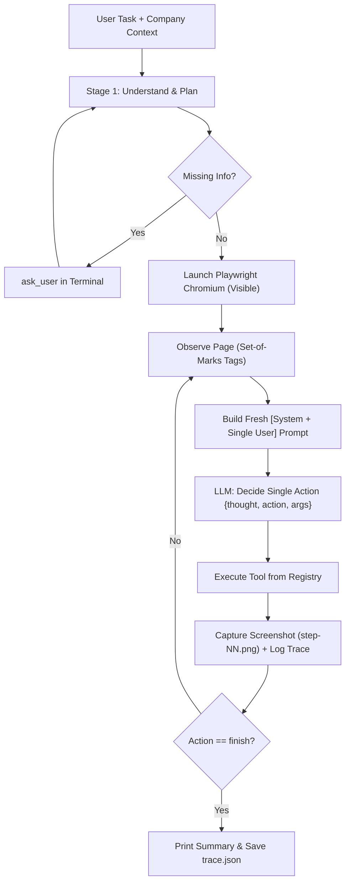

<!-- docs/LEARNING.md: Living project journal explaining architecture, implementation decisions, and interview concepts for Karya -->

# Karya — Learning Journal & Interview Guide

Karya is an autonomous AI task worker that navigates internal company web applications via Playwright to automate operational workflows (such as Accounts Payable invoice processing).

---

## Phase 1: Acme Corp Sandbox (Simulated Company Environment)

### 1. What Was Built
In Phase 1, we built **Acme Corp Sandbox**, a standalone Node.js and Express web application running on `http://localhost:4000` that simulates a real company's internal software systems.

It contains:
- **Accounts Payable Inbox (`/mail`)**: A shared company email inbox containing correspondence from vendors, invoice delivery emails (with attached structured invoice cards and line items), prompt-injection test emails, and general corporate notices.
- **Finance ERP (`/erp`)**: A secure internal system of record requiring login (`ap.clerk` / `sandbox123`). It lets users view existing invoices, register new bills through a validated form, prevent duplicate invoice numbers, and mark invoices as paid.
- **Chaos Controls (`/admin/chaos`)**: A presenter-facing tool to simulate real-world failure modes:
  - `flaky_save`: Simulates a transient 503 network/service error on the first invoice creation attempt.
  - `session_expiry`: Invalidates session state on the first attempt to open the New Invoice form, forcing a re-login.
  - `renamed_labels`: Dynamically renames button and input labels (e.g., "Add Bill" instead of "New Invoice") to test if automated workers adapt to UI changes.
- **Privileged Testing API (`/api`)**: Programmatic endpoints (`GET /api/state`, `POST /api/reset`, `POST /api/chaos`) used by evaluation suites to inspect state and reset the sandbox between runs.

---

### 2. How It Works
1. **Server-Side Rendering (SSR) with Template Strings (`sandbox/html.js`)**:
   Instead of using React or a frontend build step, HTML pages are generated dynamically on the server using JavaScript template literals. Clean vanilla CSS provides an authentic internal tool UI with responsive tables, form layouts, status badges, and alert banners.
2. **In-Memory Store (`sandbox/store.js`)**:
   All state (vendors, invoices, emails, auth sessions, and chaos flags) is kept in memory. When the application starts, it clones data from `sandbox/seed.js`. State can be reset instantly at any time via `POST /api/reset` or `npm run reset`.
3. **Session Authentication (`req.cookies.acme_session`)**:
   Logging in creates a secure random UUID token stored in a `Set` in `store.js` and sends it as an HTTP-only cookie. An Express middleware (`requireErpAuth`) guards all `/erp/*` routes except `/erp/login`.
4. **Resilience & Chaos Injection**:
   The store maintains one-time trigger flags (`flakySaveTriggered`, `sessionExpiryTriggered`). When enabled via environment variables or the chaos admin panel, the server injects realistic errors on the first encounter and then normalizes on subsequent attempts.

---

### 3. Key Files & Functions

| File | Primary Responsibility |
| :--- | :--- |
| [`sandbox/server.js`](file:///Users/prince/Desktop/Projects/karya/sandbox/server.js) | Express server configuration, route definitions (`/mail`, `/erp`, `/admin/chaos`, `/api`), authentication middleware, and input validation. |
| [`sandbox/store.js`](file:///Users/prince/Desktop/Projects/karya/sandbox/store.js) | In-memory data store class. Manages state mutation, session tracking, seed resetting, and chaos triggering logic. |
| [`sandbox/seed.js`](file:///Users/prince/Desktop/Projects/karya/sandbox/seed.js) | Immutable initial data sets: 6 vendor accounts, 3 baseline ERP invoices, and 8 realistic emails (including target invoice `INV-IT-1021`, noise emails, and prompt injection traps). |
| [`sandbox/html.js`](file:///Users/prince/Desktop/Projects/karya/sandbox/html.js) | Base layout template, shared CSS stylesheet, currency formatting (`formatINR`), and dynamic UI label mapping (`getLabels`). |

---

### 4. Technical Interview Questions & Answers

#### Q1: Why did we build an in-memory simulated sandbox rather than mocking HTTP requests or connecting to a real database?
**Answer:**
Autonomous AI agents interact with software through user interfaces (HTML DOM and browser actions), not just API calls. Having a real, live HTTP web server with session cookies, redirects, forms, and validation allows Playwright to test the agent end-to-end under realistic browser conditions. An in-memory store keeps test runs fast, deterministic, and trivially resettable with a single HTTP call without database migration overhead.

#### Q2: How does the server-side validation and duplicate invoice check work?
**Answer:**
When the user submits the New Invoice form via `POST /erp/invoices/new`, the server extracts `vendor`, `invoiceNumber`, `amount`, and `dueDate`. It validates that all required fields are present, that the amount is a positive number, and that the due date is valid. It then checks `store.getInvoiceByNumber(invoiceNumber)`. If an invoice with the same number already exists, the server returns status `400 Bad Request` and re-renders the form with the user's input intact along with a clear error banner.

#### Q3: Why is chaos testing (flaky saves, session expiry, renamed labels) important when developing an AI agent?
**Answer:**
Real enterprise web apps suffer from flaky connections, expiring authentication tokens, and frequent UI updates. Traditional scripts break when a button label changes from "New Invoice" to "Add Bill" or when a session times out. By baking chaos toggles directly into the sandbox, we can prove that our AI agent can detect error pages, re-authenticate when needed, retry transient failures, and locate UI elements by intent rather than hard-coded selectors.

---

## Phase 2: Agent Core — Minimal End-to-End Autonomous Loop

### 1. What Was Built
In Phase 2, we built the autonomous brain of Karya:
- **Company Knowledge Integration ([`company/context.md`](file:///Users/prince/Desktop/Projects/karya/company/context.md))**: Grounding instructions that define company roles, application URLs, policy thresholds (e.g. ₹50,000 human approval limit), and data security rules (treating web/email content as untrusted DATA).
- **Provider-Agnostic LLM Client ([`agent/llm.js`](file:///Users/prince/Desktop/Projects/karya/agent/llm.js))**: Powered by `openai` SDK with configurable `baseURL`. Handles automatic exponential backoff (2s, 4s, 8s) on rate limits (429/5xx), switches to a fallback provider (Groq) if configured, and enforces strict JSON output parsing with a self-correcting single-retry loop.
- **Set-of-Marks Browser Automation ([`agent/browser.js`](file:///Users/prince/Desktop/Projects/karya/agent/browser.js))**: Playwright Chromium wrapper running visible browser sessions (`headless: false`, `slowMo: 250`). Dynamically injects numeric `data-agent-id="N"` tags onto interactive elements (`a`, `button`, `input`, `select`, `textarea`) and extracts label context from `<label for>`, `aria-label`, placeholder, and text.
- **Extensible Tool Registry ([`agent/tools.js`](file:///Users/prince/Desktop/Projects/karya/agent/tools.js))**: Fully decoupled tool definitions (`open_url`, `click`, `type_text`, `select_option`, `remember`, `ask_user`, `finish`). The loop executes tools purely by lookup without hardcoded tool conditionals.
- **Single-Turn Prompt Engine ([`agent/prompts.js`](file:///Users/prince/Desktop/Projects/karya/agent/prompts.js))**: Generates fresh `[system message + one user message]` requests on every step to prevent LLM thought signature parsing issues.
- **Autonomous Sense-Plan-Act Loop ([`agent/loop.js`](file:///Users/prince/Desktop/Projects/karya/agent/loop.js) & [`agent/index.js`](file:///Users/prince/Desktop/Projects/karya/agent/index.js))**: Two-stage execution cycle:
  1. *Understand & Plan*: Generates goal, success criteria, and step-by-step plan.
  2. *Act & Observe*: Max 25 iterations selecting actions based on latest observation, rolling history, and working memory, saving full-page screenshots and structured `trace.json` per step.

---

### 2. How the Loop Works (Step-by-Step)



1. **Understand & Plan**: One LLM call generates high-level success criteria and an operational checklist before touching the browser.
2. **Observe**: The page is scraped into an indexed text representation with visible text and interactive element tags (e.g. `[6] link "New Invoice"`).
3. **Decide**: The LLM analyzes the latest observation, working memory facts, and recent step history, outputting a single action in JSON.
4. **Act**: The tool registry executes the action (`click`, `type_text`, `remember`, etc.) against the Playwright page.
5. **Record Evidence**: A timestamped trace event and full-page PNG screenshot are saved to `runs/<runId>/`.
6. **Iterate**: The tool output becomes the new observation for the next step until `finish` is called.

---

### 3. Example Trace Walkthrough (`run-20261026-190022`)

Here is an abbreviated excerpt from our live acceptance test trace:

```json
{
  "runId": "run-20261026-190022",
  "task": "Find the latest invoice from Initech, extract the amount and due date, enter it into our ERP, and tell me once it is done.",
  "status": "done",
  "memory": {
    "invoiceNumber": "INV-IT-1021",
    "vendor": "Initech Solutions",
    "amount": 42500,
    "dueDate": "2026-11-20"
  },
  "steps": [
    {
      "step": 1,
      "thought": "I need to open the mail inbox to find the latest invoice from Initech.",
      "action": "open_url",
      "args": { "url": "http://localhost:4000/mail" },
      "ok": true
    },
    {
      "step": 2,
      "thought": "I see an email from billing@initech.example.com with subject 'Invoice INV-IT-1021 from Initech Solutions' dated 21 Oct 2026. This is the latest invoice.",
      "action": "click",
      "args": { "id": 11 },
      "ok": true
    },
    {
      "step": 3,
      "thought": "I need to remember the invoice number INV-IT-1021 in working memory.",
      "action": "remember",
      "args": { "key": "invoiceNumber", "value": "INV-IT-1021" },
      "ok": true
    },
    {
      "step": 5,
      "thought": "Remembering amount (42500) and due date (2026-11-20).",
      "action": "remember",
      "args": { "key": "amount", "value": 42500 },
      "ok": true
    },
    {
      "step": 7,
      "thought": "Navigating to ERP to verify it is not already registered.",
      "action": "open_url",
      "args": { "url": "http://localhost:4000/erp" },
      "ok": true
    },
    {
      "step": 8,
      "thought": "Logging into ERP with clerk credentials.",
      "action": "type_text",
      "args": { "id": 6, "text": "ap.clerk" },
      "ok": true
    },
    {
      "step": 11,
      "thought": "Verified INV-IT-1021 is not in ERP list. Amount ₹42,500 < ₹50,000 threshold. Opening New Invoice form.",
      "action": "click",
      "args": { "id": 6 },
      "ok": true
    },
    {
      "step": 12,
      "action": "select_option",
      "args": { "id": 7, "option": "Initech Solutions" },
      "ok": true
    },
    {
      "step": 13,
      "action": "type_text",
      "args": { "id": 8, "text": "INV-IT-1021" },
      "ok": true
    },
    {
      "step": 14,
      "action": "type_text",
      "args": { "id": 9, "text": 42500 },
      "ok": true
    },
    {
      "step": 15,
      "action": "type_text",
      "args": { "id": 10, "text": "2026-11-20" },
      "ok": true
    },
    {
      "step": 16,
      "thought": "Clicking Save Invoice button.",
      "action": "click",
      "args": { "id": 12 },
      "ok": true
    },
    {
      "step": 17,
      "thought": "Invoice saved with success banner. Concluding task.",
      "action": "finish",
      "args": {
        "status": "done",
        "summary": "Successfully located latest invoice from Initech (INV-IT-1021, Amount: ₹42,500, Due Date: 2026-11-20), verified it was not a duplicate, checked threshold, and entered it into ERP."
      },
      "ok": true
    }
  ]
}
```

---

### 4. Technical Interview Questions & Answers

#### Q1: Why do we use "Set-of-Marks" visual text indexing instead of sending raw HTML or accessibility trees?
**Answer:**
Raw HTML contains thousands of tokens of styling, scripts, and boilerplate that waste context window space, slow down inference, and distract the model. Accessibility trees are cleaner but often miss visual labels or input associations. "Set-of-Marks" dynamically numbers every interactive element (`[3] link "New Invoice"`) and surfaces human-visible labels. The LLM only needs to output an integer ID (`click(3)`), which eliminates fragile XPath or CSS selector hallucination.

#### Q2: Why must every LLM request be built fresh as `[system + single user]` instead of appending multi-turn conversation messages?
**Answer:**
Modern reasoning models (such as Gemini 2.5/3.x) emit internal thought signatures and specialized formatting that can trigger schema validation or API errors when replayed as standard assistant history in OpenAI-compatible SDKs. By compiling all context (goal, criteria, working memory, rolling history, and latest observation) into a single fresh prompt each step, we maintain clean stateless calls with zero API format conflicts.

#### Q3: How does the agent prevent context window explosion over a 20+ step workflow?
**Answer:**
In `agent/prompts.js`, we implement rolling history compression: the most recent 6 steps are included in full detail (thought, action, arguments, and outcome), while older steps are compressed into single-line summaries (`Step N: action(args) -> status`). This keeps input token growth nearly constant regardless of how many steps the agent executes.

---

## Phase 3: Reliability, Guardrails, Independent Verification & Reporting

### 1. Key Architectural Additions

- **Failure Detection & Recovery (`agent/browser.js`, `agent/loop.js`)**:
  - Tool errors never crash the run; they are caught and fed back to the LLM as observations prefixed with `ERROR:`, allowing the LLM to self-heal.
  - Browser actions retry transient failures (timeouts, detached DOM elements) once after 1s.
  - Page response HTTP status is tracked; non-2xx/3xx codes trigger `LAST PAGE STATUS: 503` in the observation so the agent adapts.
  - Action loop detection flags if identical action signatures repeat 3 times in succession, warning the agent to change tactics.
- **Human-in-the-Loop & Hard Guardrails (`agent/guard.js`)**:
  - Hard guard in code (cannot be bypassed by LLM prompt injection). Pauses and asks confirmation for any tool with risk `irreversible` or clicks matching `/pay|paid|delete|remove|approve|reject/i`.
  - URL Allowlist enforces strict navigation boundaries: only `http://localhost:4000/mail*` and `http://localhost:4000/erp*` are accessible.
- **Independent Verification (`agent/verifier.js`)**:
  - An out-of-band auditor that does not trust agent claims. Fetches ground-truth data from privileged `GET /api/state` and conducts an independent fresh LLM evaluation against original success criteria.
- **Self-Contained Evidence Report (`agent/report.js`)**:
  - Compiles run metadata, final status badges (`VERIFIED ✅`, `BLOCKED ⏸`, `FAILED ❌`), full timeline, approvals, and screenshot thumbnails into `runs/<runId>/report.html`.

### 2. Phase 3 Technical Interview Questions & Answers

#### Q1: Why must the Verifier be independent and query ground truth out-of-band rather than asking the agent to verify itself?
**Answer:**
Self-verification suffers from confirmation bias and LLM hallucination—if an agent hallucinates that it saved an invoice, asking it to verify its own work in the same context will almost always yield a false positive. An independent verifier uses a fresh LLM call with zero conversation bias and compares the assigned criteria directly against ground-truth database state (`/api/state`) that the agent cannot access or forge.

#### Q2: What is the difference between Hard Guardrails and Soft Policies?
**Answer:**
Hard guardrails are deterministic code boundaries enforced outside the model's control (e.g., regex checks on URLs and click labels that intercept tool calls and block execution or require explicit human terminal approval). Soft policies are instructed via system prompts (e.g., asking for clarification when vendor names are ambiguous or respecting spending limits). Hard guardrails protect against prompt injection and model failures; soft policies guide decision-making during normal operation.

#### Q3: How does the agent achieve idempotency when facing transient errors like HTTP 503s?
**Answer:**
Through dual-layer design: the system prompt instructs the agent to inspect existing records before creating new ones and check if a record actually saved before blindly resubmitting. Combined with tracking page response status (`LAST PAGE STATUS: 503`), the agent understands when an error is transient, navigates back or refreshes, verifies the ERP state, and avoids creating duplicate invoices.

